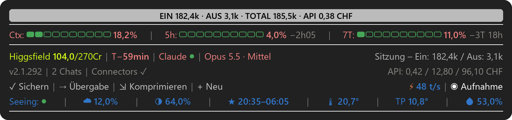
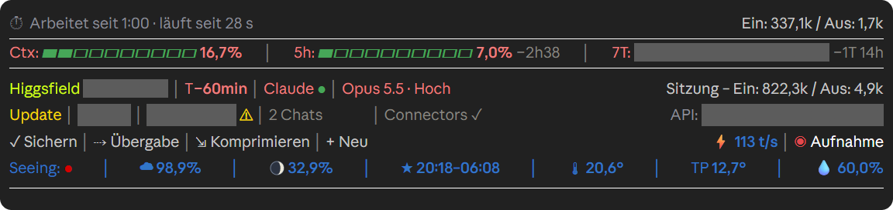

# ROQAM – Readout & Quick Access Mod: Anleitung

Eine Info-Leiste für Claude Code. Sie steht über dem Eingabefeld, in der Konsole und in der Desktop-App
(Windows 11). Auf einen Blick zeigt sie, wie voll der Chat ist, wie viel vom Abo-Limit verbraucht ist, wann der
Zwischenspeicher verfällt und ob die Dienste von Anthropic laufen. Ein paar Knöpfe erledigen Alltägliches mit
einem Klick. Die unterste Zeile zeigt den Himmel heute Nacht und das Wetter an deinem Ort.



In der Desktop-App, während Claude arbeitet. Die Aufnahme ist eingeschaltet, darum sind private Werte grau abgedeckt.



Es gibt zwei Fassungen: `roqam-de` mit deutscher und `roqam` mit englischer Beschriftung. Beide arbeiten gleich.
Die deutsche hat aber deutsche Namen für die Einstellungen und rechnet die API-Kosten in CHF (siehe
[Einstellungen](#einstellungen)). Diese Anleitung beschreibt die deutsche Fassung, die englische
steht in [README.md](README.md).

ROQAM ist ein unabhängiges Projekt. Anthropic hat es weder gebaut noch empfohlen.

## Voraussetzungen

- Windows 11
- Claude Code 2.1.289 oder neuer, in der Konsole oder der Desktop-App

## Installieren

Es gibt drei Wege. Nimm nur einen davon und nur eine Fassung, sonst laufen zwei Leisten.

### Per Doppelklick

Auf der GitHub-Seite **Code** → **Download ZIP** wählen, das ZIP entpacken und `Install.bat` doppelklicken. Das
Skript fragt nach der Sprache (bei deutschem Windows ist Deutsch vorgeschlagen) und nach deinem Ort für Himmel und
Wetter. Es kopiert die Leiste nach `C:\Users\DEINNAME\.claude\mods\` und trägt sie in `settings.json` ein. Vorher
legt es eine Kopie deiner `settings.json`, eine ältere Kopie der Leiste und die andere Sprachfassung in
`C:\Users\DEINNAME\.claude\backups\` ab. Gelöscht wird nichts. Danach Claude Code ganz beenden und neu starten.
Warnt Windows beim Start («Der Computer wurde durch Windows geschützt»), auf «Weitere Informationen» und dann
«Trotzdem ausführen» klicken.

### Mit der Plugin-Verwaltung

In einem Terminal:

```
claude plugin marketplace add Telefaxnix/ROQAM
claude plugin install roqam-de@roqam --config ort=Bern
```

`Bern` durch deinen Ort ersetzen. Ohne `--config ort=Bern` gibt es keine Himmel- und Wetteranzeige. Danach Claude Code ganz beenden und neu starten. Die Desktop-App liest dieselbe
`settings.json`, die Leiste erscheint also auch dort.

Aktualisieren mit `claude plugin marketplace update roqam` und danach `claude plugin update roqam-de@roqam`.
Entfernen mit `claude plugin uninstall roqam-de@roqam`.

### Von Hand

1. Das ZIP wie oben beschrieben herunterladen und entpacken.
2. Den Ordner `roqam-de` nach `C:\Users\DEINNAME\.claude\mods\roqam-de` kopieren (Ordner `mods` anlegen, falls
   er fehlt).
3. `C:\Users\DEINNAME\.claude\settings.json` öffnen (fehlt sie: neu anlegen) und diese zwei Blöcke ergänzen.
   `DEINNAME` und den Ort ersetzen; ein leerer `ort` heisst: keine Himmel- und Wetteranzeige.

   ```json
   {
     "env": {
       "CLAUDE_CODE_PLUGIN_DIRS": "C:\\Users\\DEINNAME\\.claude\\mods\\roqam-de"
     },
     "pluginConfigs": {
       "roqam-de": {
         "options": {
           "ort": "Bern",
           "apiKosten": true,
           "higgsfield": true,
           "aktionen": true
         }
       }
     }
   }
   ```

   Steht schon etwas in der Datei, die Blöcke dazuschreiben statt alles zu ersetzen, und auf die Kommas achten.
   Stehen in `CLAUDE_CODE_PLUGIN_DIRS` schon andere Ordner, den neuen Pfad hinten anhängen, getrennt mit `;`.
4. Claude Code ganz beenden und neu starten.

### Entfernen

Mit der Plugin-Verwaltung: siehe oben. Sonst den Pfad der Leiste aus `CLAUDE_CODE_PLUGIN_DIRS` in `settings.json`
nehmen und Claude Code neu starten.

## Was die Leiste zeigt

| Anzeige | Bedeutung |
|---|---|
| Oberstes Band | Solange Claude arbeitet: woran, kurz aus deinem Auftrag zusammengefasst, und bei einer Aufgabenliste, wie weit (`▰▰▰▱▱ 3/5`). Mit `/goal …` steht dein Ziel da. Ist Claude fertig: Tokens ein und aus seit deiner letzten Nachricht und was diese Arbeit zum API-Preis gekostet hätte (`EIN 182,4k · AUS 3,1k · TOTAL 185,5k · API 0,38 CHF`). |
| ⏱ Arbeitet seit … | Solange Claude arbeitet: wie lange schon, welcher Schritt zuletzt lief und wie viele Tokens bisher. Dauert ein Schritt über 4 Minuten oder ruft Claude dreimal hintereinander dasselbe auf, fragt die Leiste, ob es weitergehen soll. |
| Ctx | Wie voll der Chat ist. Bei 75 % und nochmals bei 90 % schlägt ein Hinweis `/compact` vor. |
| 5h / 7T | Wie viel vom Fünf-Stunden- und vom Sieben-Tage-Limit deines Abos verbraucht ist, und wann es zurückgesetzt wird. |
| Higgsfield 104,0/270Cr | Deine Higgsfield-Credits. Sie erscheinen von selbst, sobald der claude.ai-Connector «Higgsfield» verbunden ist, auch wenn du ihn erst später verbindest. |
| T− | Minuten, bis der Zwischenspeicher des Chats verfällt. Gerechnet wird ab Claudes letzter Anfrage mit 60 Minuten Laufzeit (`T−55min`; grau `T−0` heisst verfallen). Danach liest die nächste Nachricht den ganzen Chat neu ein, das kostet mehr Limit. |
| Claude ● | Status von Anthropic: grün heisst, die genutzten Dienste laufen, gelb beeinträchtigt, rot Ausfall, grau keine Verbindung zur Statusseite. Ein Klick auf «Claude» zeigt die Meldung; jede Störung (↗) öffnet ihre Seite auf status.claude.com. |
| Opus 5.5 · Mittel | Modell und Denkstufe dieses Chats. |
| Sitzung – Ein / Aus | Tokens, die dieser Chat bisher gelesen und geschrieben hat. |
| v2.1.292 / Update | Deine Version von Claude Code. Ein gelbes «Update» heisst, es gibt eine neuere; ein Klick zeigt, welche. |
| 2 Chats | Laufende Claude-Sitzungen auf diesem PC. Ein Klick zeigt die Liste; App-Chats (↗) öffnen sich per Klick. |
| Connectors | Die MCP-Server dieses Chats, claude.ai-Connectors und lokale; gelb, wenn einer abreisst. |
| ⚑ Neue Aktion | Erscheint nur, wenn Anthropic eine Aktion ändert, etwa Cloud-Guthaben, Gästepässe, Rabatte oder Hinweise zum Nutzungslimit. Ein Klick zeigt, was neu ist. |
| API: | Was dieser Chat, dieses Projekt und der laufende Abo-Monat zum API-Listenpreis gekostet hätten, in CHF. |
| ✓ Sichern | Schreibt einen Auftrag ins Eingabefeld: Claude geht den Chat durch, ergänzt ohne Rückfrage, was in den Projektnotizen und im Gedächtnis fehlt, committet die geänderten Projektdateien und lädt sie hoch, falls es eine Online-Kopie gibt. Abschicken tust du selbst. |
| ⇢ Übergabe | Startet deinen Skill `/handoff`, falls du einen hast. Sonst schreibt sie den Auftrag für eine kurze Übergabe ins Eingabefeld. |
| ⇲ Komprimieren | Fasst den Chat zusammen (`/compact`), nach einer Rückfrage. |
| + Neu | Öffnet einen neuen Chat im selben Ordner (Desktop-App: neuer Chat; Konsole: neues Fenster). |
| ⚡ … t/s | Wie schnell die letzte Antwort kam, in Tokens pro Sekunde. |
| ◉ Aufnahme | Aufnahmemodus für Bildschirmaufnahmen: verdeckt in allen offenen Chats Pfade, Kosten, Konten, den Prozentwert von 7T, die Zusammenfassung deines Auftrags und den Schritt. Weiss ist aus, rot ist an. Läuft OBS, Streamlabs, Bandicam oder Camtasia, schaltet er sich von selbst ein. |
| Seeing: ● | Der Himmel heute Nacht an deinem Ort, in elf Stufen von grün bis rot. Grün: klar und ruhig, ein Blick nach draussen lohnt sich. Gegen rot: Wolken, unruhige Luft, heller Mond oder feuchte Luft. Grau: keine Daten. |
| ☁ / Mond / ★ | Wolken in der Nacht, Mondphase sowie Beginn und Ende der astronomischen Dunkelheit. |
| 🌡 / TP / 💧 | Temperatur, Taupunkt und Luftfeuchtigkeit, alle 10 Minuten neu. |

Im Chat selbst markiert ROQAM das Ende jeder fertigen Antwort mit einem grauen Band «CLAUDE BEREIT». Fragt Claude
mitten in einer Aufgabe nach, steht über der Frage ein goldenes Band: Deine Antwort setzt die laufende Aufgabe fort.

Ein Klick auf Claude ●, die Version, Chats, Connectors, ⚑, API: oder ⚡ zeigt mehr. Nochmals klicken oder
30 Sekunden warten schliesst das Kärtchen.

`/stars` blendet Himmel und Wetter aus und stoppt die Wetterabfragen; nochmals `/stars` holt sie zurück. Die
Wahl gilt in allen Chats, auch nach einem Neustart. Wo sich der Hinweis «⚑ Neue Aktion» nicht anklicken lässt,
bestätigt ihn `/aktion-gesehen`.

### Zusätzliche Anzeigen aus eigenen Dateien

Cloud-Guthaben und Gratis-Resets meldet Claude Code nicht an Mods. Wer sie trotzdem sehen will, führt die Datei
`~\.claude\statusleiste-guthaben.json` mit einer Liste von Einträgen, etwa
`[{"name": "Cloud-Guthaben", "kurz": "Cloud $", "rest": 40, "total": 50, "einheit": "USD", "ablauf": "2026-12-31"}]`.
Die Leiste zeigt jeden Eintrag mit den Resttagen, unter 7 Tagen mit ⚠; `"verbraucht": true` blendet ihn aus.
Die Warnung «⚠ GitHub» erscheint nur, wenn ein eigenes Abgleich-Skript `~\.claude\github-abgleich.json` schreibt.
Ohne diese Dateien erscheint nichts davon.

## Einstellungen

Die Einstellungen stehen in `settings.json` unter `pluginConfigs` → `roqam-de` → `options`. Mit der
Plugin-Verwaltung stehen sie unter `pluginConfigs` → `roqam-de@roqam` → `options`, und
`claude plugin configure roqam-de@roqam` zeigt sie an. Nach einer Änderung Claude Code neu starten.

| Einstellung | Standard | Wirkung |
|---|---|---|
| `ort` | leer | Ort für Himmel und Wetter, z. B. `"Bern"`. Leer: keine Himmel- und Wetteranzeige. |
| `apiKosten` | `true` | Zeigt, was dieser Chat, dieses Projekt und der Abo-Monat über die API gekostet hätten, in CHF. |
| `higgsfield` | `true` | Zeigt deine Higgsfield-Credits, sobald der claude.ai-Connector «Higgsfield» verbunden ist. `false` blendet sie aus. |
| `higgsfieldMax` | `270` | Credits pro Monat in deinem Higgsfield-Abo. |
| `aktionen` | `true` | Zeigt «⚑ Neue Aktion», wenn Anthropic eine Aktion ändert. |
| `wetterUrl` | leer | Adresse der Schnittstelle deiner eigenen Wetterstation. Wirkt nur zusammen mit `ort`. Leer: Temperatur, Taupunkt und Feuchte von Open-Meteo. |
| `neuOrdner` | leer | Ordner, in dem «+ Neu» den neuen Chat öffnet. Leer: der Ordner des aktuellen Chats. |

## Datenschutz

Alles, was die Leiste speichert, bleibt auf deinem PC. Sie fragt nur öffentliche Dienste ohne Konto ab:

| Dienst | Wofür |
|---|---|
| Open-Meteo (`api.open-meteo.com`, `geocoding-api.open-meteo.com`) | Wetter, Wolken, Ort finden |
| 7Timer (`www.7timer.info`) | Seeing |
| status.claude.com | Störungen |
| npm-Registry (`registry.npmjs.org`) | Neueste Version von Claude Code |
| Deine eigene Wetterstation (`wetterUrl`) | Nur wenn eingetragen |
| Frankfurter (`api.frankfurter.app`) | Kurs USD–CHF, bei eingeschalteten API-Kosten |

Auf deinem PC liest sie die eigenen Dateien von Claude Code: `~\.claude.json` (Aktionen und Beginn deines Abos),
`~\.claude\sessions` (laufende Chats) und den Verlauf des aktuellen Chats (für `T−`). Für die API-Kosten liest sie
auch deine übrigen Verläufe und schreibt ein Kostenbuch samt Sicherungskopie nach
`~\.claude\api-kostenbuch.json`. Sie startet `tasklist`, PowerShell, `rundll32` und `wt.exe`. Für die
Zusammenfassung im obersten Band fragt sie Claude Haiku über deine eigene Sitzung; das braucht einen kleinen Teil
deines Abos. Ausführlich, auf Englisch: [PRIVACY.md](PRIVACY.md).

## Wenn etwas nicht klappt

- Claude Code mit `claude --debug` starten; Zeilen mit `roqam` zeigen, was schiefgeht.
- Keine Higgsfield-Credits in der Desktop-App: in `settings.json` unter `"permissions": { "allow": [ … ] }` die
  Abfrage `balance` des Higgsfield-Connectors erlauben.
- Verwaltet deine Organisation Claude Code zentral, hinkt die Anzeige des Kontexts direkt nach `/compact` bis zur
  nächsten Aktualisierung nach.

## Quellen

Wetter- und Wolkendaten von [Open-Meteo.com](https://open-meteo.com/) (CC BY 4.0; gratis für nicht-kommerzielle
Nutzung). Seeing-Vorhersagen von [7Timer](https://www.7timer.info/) (gratis für nicht-kommerzielle Nutzung).

## Lizenz

© 2026 Dominik Sieber. Nach deiner Wahl gilt die MIT-Lizenz ([LICENSE-MIT](LICENSE-MIT)) oder die Apache-Lizenz 2.0
([LICENSE-APACHE](LICENSE-APACHE)).
