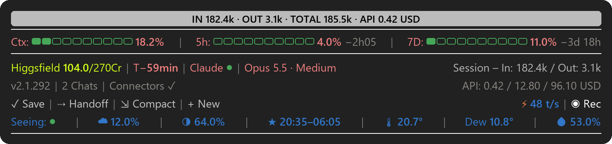

# ROQAM – Readout & Quick Access Mod

A status bar for Claude Code. It sits above the prompt in the terminal and in the desktop app (Windows 11) and
shows at a glance how full your context is, how much of your plan limits you have used, when the prompt cache
expires and whether Anthropic's services are up. A few buttons handle everyday steps with one click, and the
bottom line shows tonight's sky and the weather where you are.



In the desktop app while Claude is working (German version). Recording mode is on, so private values are greyed out.


There are two versions: `roqam` with English labels and `roqam-de` with German labels. They work the same way,
but the German version uses German setting names and shows API costs in CHF (see [Settings](#settings)). The German guide is [ANLEITUNG.md](ANLEITUNG.md).

ROQAM is an independent project. Anthropic did not make it and does not endorse it.

## Requirements

- Windows 11
- Claude Code 2.1.289 or newer, in the terminal or the desktop app

## Install

There are three ways. Use only one of them and install only one version, otherwise two bars will run.

### Double-click

On this page, click **Code** → **Download ZIP**, unzip the file and double-click `Install.bat`. The installer asks
for the language of the labels (it suggests the language of Windows) and for your location, the town used for sky
and weather. It copies the mod to `C:\Users\YOURNAME\.claude\mods\` and adds it to `settings.json`. Before that it
puts a copy of your `settings.json`, an older copy of the mod and the other language version into
`C:\Users\YOURNAME\.claude\backups\`; nothing is deleted. Then quit Claude Code completely and start it again. If
Windows SmartScreen warns you, choose "More info" and then "Run anyway".

### Plugin manager

In a terminal:

```
claude plugin marketplace add Telefaxnix/ROQAM
claude plugin install roqam@roqam --config location=London
```

Use your own town instead of London, or leave out `--config location=London` if you don't want sky and weather.
For German labels, install `roqam-de@roqam --config ort=Bern` instead; the German version calls the setting
`ort`. Then quit Claude Code completely and start it again. The desktop app reads
the same `settings.json`, so the bar shows up there too.

Update with `claude plugin marketplace update roqam` and then `claude plugin update roqam@roqam`. Remove it with
`claude plugin uninstall roqam@roqam`.

### By hand

1. Download the ZIP as described above and unzip it.
2. Copy the folder `roqam` to `C:\Users\YOURNAME\.claude\mods\roqam` (create the `mods` folder if needed).
3. Open `C:\Users\YOURNAME\.claude\settings.json` (create it if needed) and add these two blocks. Replace
   `YOURNAME` and `London`; leave `location` empty if you don't want sky and weather.

   ```json
   {
     "env": {
       "CLAUDE_CODE_PLUGIN_DIRS": "C:\\Users\\YOURNAME\\.claude\\mods\\roqam"
     },
     "pluginConfigs": {
       "roqam": {
         "options": {
           "location": "London",
           "apiCost": true,
           "higgsfield": true,
           "promotions": true
         }
       }
     }
   }
   ```

   If the file already has content, merge the blocks into it and mind the commas. If `CLAUDE_CODE_PLUGIN_DIRS`
   already lists other folders, add the new path at the end, separated by `;`.
4. Quit Claude Code completely and start it again.

### Uninstall

With the plugin manager, see above. Otherwise remove the mod's path from `CLAUDE_CODE_PLUGIN_DIRS` in
`settings.json` and restart Claude Code.

## What the bar shows

| Item | Meaning |
|---|---|
| Top band | While Claude works: a short summary of your request and, if Claude keeps a task list, its progress (`▰▰▰▱▱ 3/5`). With `/goal …` it shows your goal instead. When Claude is done: tokens in and out since your last message and what that work would have cost at API prices (`IN 182.4k · OUT 3.1k · TOTAL 185.5k · API 0.42 USD`). |
| ⏱ Working for … | While Claude works: how long it has been running, the last step, and the tokens so far. If a step takes more than 4 minutes, or Claude repeats the same call three times, it asks whether to continue. |
| Ctx | How full the chat's context is. At 75% and again at 90% a hint suggests `/compact`. |
| 5h / 7D | How much of your plan's five-hour and seven-day limits you have used, and when each resets. |
| Higgsfield 104.0/270Cr | Your Higgsfield credits. They appear by themselves once the claude.ai connector "Higgsfield" is connected, even if you connect it later. |
| T− | Minutes until the prompt cache expires, counted from Claude's last request with a lifetime of 60 minutes (`T−55min`; grey `T−0` means expired). After that, your next message has to read the whole chat again, which costs more of your limit. |
| Claude ● | Anthropic status: green means the services you use are up, yellow degraded, red down, grey no connection to the status page. Click "Claude" for details; each incident (↗) opens its page on status.claude.com. |
| Opus 5.5 · Medium | Model and effort level of this chat. |
| Session – In / Out | Tokens this chat has read and written so far. |
| v2.1.292 / Update | Your Claude Code version. A yellow "Update" means a newer version is out; click it to see which. |
| 2 Chats | Claude sessions running on this PC. Click for the list; app chats (↗) open on click. |
| Connectors | The MCP servers of this chat, claude.ai connectors and local ones; turns yellow when one drops. |
| ⚑ New promotion | Shows up only when Anthropic changes a promotion, such as cloud credits, guest passes, discounts or usage-limit notices. Click it to see what changed. |
| API: | What this chat, this project and the current plan month would have cost at API list prices. |
| ✓ Save | Puts a request into the prompt box: Claude goes through the chat, adds what is missing to the project notes and its memory without asking, commits the changed project files and pushes them if the project has an online copy. You send it yourself. |
| ⇢ Handoff | Runs your `/handoff` skill if you have one. Otherwise it puts a request for a short handoff into the prompt box. |
| ⇲ Compact | Compacts the chat (`/compact`) after asking. |
| + New | Opens a new chat in the same folder (desktop app: new chat; terminal: new window). |
| ⚡ … t/s | How fast the last answer streamed, in tokens per second. |
| ◉ Rec | Recording mode: hides paths, costs, accounts, the seven-day percentage, the summary of your request and the step text in all open chats, for screen recordings. White is off, red is on. It turns on by itself while OBS, Streamlabs, Bandicam or Camtasia runs. |
| Seeing: ● | Tonight's sky where you are, in eleven steps from green to red. Green: clear and steady, worth a look outside. Towards red: clouds, unsteady air, bright moon or damp air. Grey: no data. |
| ☁ / moon / ★ | Cloud cover after dark, moon phase, and the start and end of astronomical darkness. |
| 🌡 / Dew / 💧 | Temperature, dew point and humidity, updated every 10 minutes. |

In the chat itself, ROQAM marks the end of each answer with a grey "CLAUDE READY" band. When Claude asks you
something in the middle of a task, a gold band above the question says that your answer continues the current
task.

Click Claude ●, the version, Chats, Connectors, ⚑, API: or ⚡ for details. Click again, or wait 30 seconds, to
close the card.

`/stars` hides sky and weather and stops the weather requests; run it again to bring them back. The setting
applies to all chats and survives restarts. Where the promotion notice can't be clicked, `/promo-seen` dismisses
it (German version: `/aktion-gesehen`).

### Optional entries from your own files

Claude Code doesn't tell mods about cloud credits or free resets. If you want to see them anyway, keep a file
`~\.claude\statusleiste-guthaben.json` with a list of entries such as
`[{"name": "Cloud credits", "kurz": "Cloud $", "rest": 40, "total": 50, "einheit": "USD", "ablauf": "2026-12-31"}]`.
The bar shows each entry with the days left and a ⚠ when fewer than 7 remain; `"verbraucht": true` hides one.
A "⚠ GitHub" warning appears only if a sync script of your own writes `~\.claude\github-abgleich.json`. Without
these files, nothing appears.

## Settings

The settings live in `settings.json` under `pluginConfigs` → `roqam` → `options`. If you used the plugin manager,
they are under `pluginConfigs` → `roqam@roqam` → `options`, and `claude plugin configure roqam@roqam` shows them.
Restart Claude Code after a change.

| Setting | German version | Default | What it does |
|---|---|---|---|
| `location` | `ort` | empty | Town for sky and weather, e.g. `"London"`. Empty: no sky and weather. |
| `apiCost` | `apiKosten` | `true` | Shows what this chat, this project and the plan month would have cost via the API, in USD (German version: CHF). |
| `higgsfield` | `higgsfield` | `true` | Shows your Higgsfield credits whenever the claude.ai connector "Higgsfield" is connected. `false` hides them. |
| `higgsfieldMax` | `higgsfieldMax` | `270` | Credits per month in your Higgsfield plan. |
| `promotions` | `aktionen` | `true` | Shows "⚑ New promotion" when Anthropic changes a promotion. |
| `weatherUrl` | `wetterUrl` | empty | Address of your own weather station's API. Works only together with `location`. Empty: temperature, dew point and humidity come from Open-Meteo. |
| `newChatFolder` | `neuOrdner` | empty | Folder in which "+ New" opens the new chat. Empty: the folder of the current chat. |

## Privacy

Everything the bar stores stays on your PC. It only contacts public services that need no account:

| Service | What for |
|---|---|
| Open-Meteo (`api.open-meteo.com`, `geocoding-api.open-meteo.com`) | Weather, cloud cover, finding your town |
| 7Timer (`www.7timer.info`) | Seeing forecast |
| status.claude.com | Incidents |
| npm registry (`registry.npmjs.org`) | Latest Claude Code version |
| Your own weather station (`weatherUrl`) | Only if you set it |
| Frankfurter (`api.frankfurter.app`) | USD to CHF rate (German version only, with API costs on) |

On your PC it reads Claude Code's own files: `~\.claude.json` (promotions and the start date of your plan),
`~\.claude\sessions` (running chats) and the transcript of the current chat (for `T−`). For the API costs it also
reads your other transcripts and keeps a cost log with a backup copy in `~\.claude\`. It runs `tasklist`,
PowerShell, `rundll32` and `wt.exe`. For the summary in the top band it asks Claude Haiku through your own Claude
Code session, which uses a small part of your plan. Details: [PRIVACY.md](PRIVACY.md).

## Troubleshooting

- Start Claude Code with `claude --debug`; lines with `roqam` show what goes wrong.
- No Higgsfield credits in the desktop app: allow the connector's `balance` tool under
  `"permissions": { "allow": [ … ] }` in `settings.json`.
- If your organisation manages Claude Code centrally, the context figure right after `/compact` may lag until
  the next update.

## Credits

Weather and cloud data from [Open-Meteo.com](https://open-meteo.com/) (CC BY 4.0; free for non-commercial use).
Seeing forecasts from [7Timer](https://www.7timer.info/) (free for non-commercial use).

## License

Copyright 2026 Dominik Sieber. Licensed under either the MIT License ([LICENSE-MIT](LICENSE-MIT)) or the Apache
License 2.0 ([LICENSE-APACHE](LICENSE-APACHE)), at your option.
